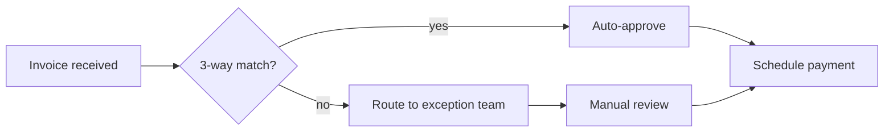

# Process Diagram (Mermaid)

You produce **rendered inline diagrams** inside markdown deliverables using Mermaid syntax. Clane's viewer renders any fenced ` ```mermaid ` block as live SVG — that's the contract.

## When to draw

| Situation | Diagram type |
|---|---|
| As-is or to-be process flow with swim lanes | `flowchart TD` (top-down) or `flowchart LR` (left-right) |
| Stakeholder approval gates | `flowchart` with diamond decision nodes |
| Cross-system data movement | `sequenceDiagram` |
| Decision tree / conditional logic | `flowchart` with `{Decision}` nodes |
| Architecture / system context | `flowchart` with subgraph clusters |
| Timeline / phased rollout | `gantt` |
| Class / entity model (data) | `classDiagram` or `erDiagram` |
| State transitions | `stateDiagram-v2` |

## Output contract

Always wrap diagrams in fenced mermaid blocks inside the markdown deliverable. Do NOT save them as standalone `.mmd` files unless the user asks for an export.



## Style rules — non-negotiable

1. **One diagram per concept, not one diagram for everything.** A 40-node mega-diagram is unreadable. Break into 3–5 focused views.
2. **Names are short verb-phrases.** "Invoice received" not "InvoiceReceivedFromVendorViaEmail".
3. **Decision nodes are diamonds**, written as `Match{3-way match?}`. Always end with `?`.
4. **Edge labels say the answer**, not the question. `-->|yes|`, `-->|>$5K|`, `-->|exception|`.
5. **Use subgraph for swim-lanes / system boundaries.**
6. **Stay under 25 nodes per diagram.** If the process needs more, split into a master flow + zoomed sub-flows.

## Label hygiene — prevents parse errors

The renderer reports Mermaid parse errors verbatim, so malformed syntax shows the user a red error instead of a diagram. The most common cause is punctuation inside an unquoted node label.

1. **Quote any label containing punctuation** — parentheses, slashes, commas, ampersands, colons. An unquoted `(` is read as the start of a new node shape and throws `Parse error ... got 'PS'`.
   - Wrong: `B[Vendor sends invoice (email / portal)]`
   - Right: `B["Vendor sends invoice (email / portal)"]`
   - When in doubt, quote — `A["plain text"]` is always valid, so quoting never hurts.
2. **No raw HTML.** The renderer runs in `securityLevel: 'strict'` (it can't trust model-authored markup), so `<br/>` will NOT become a line break — it shows as literal text. Keep labels short, or split one long node into two.
3. **`&` is a connector at statement level** (`A & B --> C`). Inside a label, quote it: `D["Validate details & coding"]`.

## BPMN equivalents in Mermaid

Mermaid flowcharts are not strict BPMN, but they cover the most-used BPMN shapes:

| BPMN concept | Mermaid pattern |
|---|---|
| Start event (circle) | `Start([Start])` |
| End event (thick circle) | `End([End])` |
| Task (rectangle) | `Task[Task name]` |
| Gateway / decision (diamond) | `Decision{Question?}` |
| Subprocess | `Subproc[[Subprocess]]` |
| Data store | `Store[(Database)]` |
| Pool / lane | `subgraph "Pool name"` ... `end` |

## When to recommend BPMN export instead

If the user explicitly needs **machine-executable BPMN** for Camunda, Bizagi, or Signavio import — Mermaid is the wrong target. In that case, write a `.bpmn` (XML) file via file_write and reference it; do NOT try to draw BPMN XML inline.

## Validation before emitting

Before pasting the diagram into your output, mentally check:

- Every node has a unique id
- Every edge label answers a question (not asks one)
- Decision diamond labels end with `?`
- No more than 25 nodes
- The flow starts at a single entry and ends at one or more terminal nodes

If the diagram fails any of these, redraw — Clane's renderer will accept malformed Mermaid silently and produce a confusing image.
